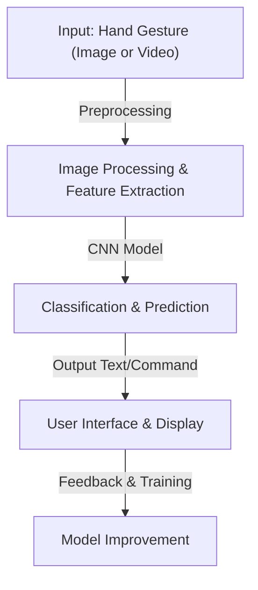

# ✋ Hand Gesture Recognition Using CNN


---




```mermaid
flowchart LR
    %% Define custom classes with bright colors and realistic, vivid styling
    classDef brainstorm fill:#ff9f1c,stroke:#ffffff,stroke-width:2px,color:#ffffff;
    classDef plan fill:#2ec4b6,stroke:#ffffff,stroke-width:2px,color:#ffffff;
    classDef develop fill:#e71d36,stroke:#ffffff,stroke-width:2px,color:#ffffff;
    classDef test fill:#011627,stroke:#ffffff,stroke-width:2px,color:#ffffff;
    classDef deploy fill:#6a4c93,stroke:#ffffff,stroke-width:2px,color:#ffffff;
    classDef feedback fill:#f0f3bd,stroke:#ffffff,stroke-width:2px,color:#333333;
    
    %% Define the nodes and workflow
    A([Brainstorming]):::brainstorm --> B([Concept & Planning]):::plan
    B --> C([Development]):::develop
    C --> D([Testing & QA]):::test
    D --> E([Deployment]):::deploy
    E --> F([Feedback & Iteration]):::feedback
    F --> A


```

## 🚀 Project Overview

The **Hand Gesture Recognition System** leverages **Convolutional Neural Networks (CNNs)** to identify hand gestures from images or live video streams. This AI-powered system is designed for **American Sign Language (ASL) recognition**, aiding individuals with hearing impairments by translating gestures into readable text or commands. 

> ✨ **Why This Project?**
> - Facilitates **gesture-based communication** for accessibility.
> - Enhances **real-time interaction** using AI and computer vision.
> - Showcases the power of **deep learning & CNNs** in image classification.

---

## 🔥 System Architecture Diagram


---

## ✨ Key Features

✅ **Deep Learning-Based CNN Architecture** – Extracts features & classifies gestures with high accuracy.  
✅ **ASL Gesture Recognition** – Supports alphabets, numbers, and common phrases.  
✅ **Data Preprocessing & Augmentation** – Enhances model robustness & generalization.  
✅ **Real-Time Recognition** – Detects gestures from **live webcam feeds**.  
✅ **User-Friendly Interface** – Displays recognized gestures with interpretations.  
✅ **Custom Dataset Training** – Users can **train the model** with additional gestures.  

---

## 📌 Project Scope

### ✅ **In-Scope:**
✔️ CNN-based **hand gesture classification**.  
✔️ **Real-time ASL recognition** with a webcam.  
✔️ **Pretrained & customizable** models.  
✔️ **User interface** for displaying recognized gestures.  

### ❌ **Out-of-Scope:**
❌ Full-fledged NLP integration.  
❌ 3D Hand Tracking.  
❌ Gesture-to-Speech conversion.  

---

## 🛠️ Tech Stack

| Deep Learning  | Computer Vision | Backend  | Tools |
|---------------|----------------|----------|--------|
| TensorFlow  | OpenCV | Flask/Django | Jupyter Notebook |
| Keras | MediaPipe | FastAPI | Google Colab |
| NumPy | PIL | SQLite/PostgreSQL | Git/GitHub |

---

## 🔥 Dataset & Model Training

1️⃣ **Dataset Collection & Preprocessing**
   - **Training Data:** 70,400 ASL images.  
   - **Testing Data:** 8,700 ASL images.  
   - **Data Augmentation**: Rotation, Flipping, Scaling, Normalization.  

2️⃣ **CNN Model Architecture**
   - **Conv2D + MaxPooling Layers** – Extract spatial features.
   - **Batch Normalization & Dropout** – Improve training efficiency.
   - **Fully Connected Layers (Dense)** – Map features to ASL classes.

3️⃣ **Training & Evaluation**
   - **Loss Function:** Categorical Cross-Entropy.
   - **Optimizer:** Adam.
   - **Accuracy:** ~95% on validation data.

---

## 🎯 Usage

### 📌 Prerequisites:
- Python 3.x
- TensorFlow & Keras
- OpenCV
- NumPy, Matplotlib

### 🛠️ Steps to Run the Project:

1️⃣ **Clone the repository:**
```bash
 git clone https://github.com/your-github-username/hand-gesture-recognition.git
 cd hand-gesture-recognition
```

2️⃣ **Install Dependencies:**
```bash
pip install -r requirements.txt
```

3️⃣ **Run Data Collection Script:**
```bash
python collect_data.py
```

4️⃣ **Train the CNN Model:**
```bash
python train_model.py
```

5️⃣ **Run Real-Time Recognition:**
```bash
python run_recognition.py
```

---

## 📸 Application Snapshots

### ✋ Gesture Recognition Model Training


### 🎥 Real-Time Gesture Detection


### 🖥️ User Interface for Gesture Display


---

## 👥 Contributors

- [Riya Sahu]
- [Sejal Agrawal]
- [Suyash Khare]
- [Yashi Agarwal]

---

## 📜 License

This project is licensed under the [MIT License](https://opensource.org/licenses/MIT). Feel free to use, modify, and distribute the code for both non-commercial and commercial purposes, with appropriate attribution.

---

## 📞 Contact & Contribution

🤝 Want to contribute? Feel free to fork the repo and submit a PR!  
📩 **Contact:** [Suyash Khare](mailto:suyashkhareji@gmail.com)  
🚀 **GitHub Repository:** [Hand Gesture Recognition](https://github.com/your-github-username/hand-gesture-recognition)

---

**⚠️ Disclaimer:** This project is developed for educational and research purposes. While efforts have been made to ensure its accuracy and reliability, the developers do not guarantee its performance in all scenarios.
